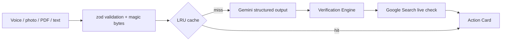

# LifeBridge — messy input in, verified life-saving action out

**LifeBridge** is a Gemini-powered web app that acts as a universal bridge between human intent and emergency systems. It takes unstructured real-world input — a panicked voice note, a photo of a prescription, a scanned lab report, a forwarded flood alert, mixed-language text — and instantly converts it into a **structured, verified Action Card**: severity, prioritized actions, evidence-backed facts, verified emergency contacts, and a shareable SMS summary.

> Built for **Hack2skill PromptWars x Hoollow**. Challenge: *"Build a Gemini-powered App that solves for societal benefit by acting as a universal bridge between human intent and complex systems … converts [messy inputs] into structured, verified, and life-saving actions."*

---

## The problem

In a crisis, information is messy. Responders, hospitals and caregivers need structure: what happened, how severe it is, what to do now, whom to call. Generic chatbots answer in free text, can invent facts and phone numbers, and never show which statements are grounded in the input.

## The solution

| Step | What happens | Where |
|---|---|---|
| 1. **Intake** | Text in any language, browser voice recording, photos, PDFs (up to 4 files) | `public/` |
| 2. **Structure** | Gemini (multimodal) returns JSON constrained by a schema generated from zod | `src/services/gemini.ts`, `src/domain/schema.ts` |
| 3. **Verify** | Deterministic Verification Engine: evidence grounding, confidence, phone number guard, dosage guard, critical escalation, prompt-injection check | `src/domain/verify.ts` |
| 4. **Cross-check** (optional) | Gemini with **Google Search grounding** checks key claims against live public sources | `src/services/gemini.ts` |
| 5. **Act** | Action Card: `tel:` buttons from a verified directory, ordered actions, read aloud, SMS text, JSON, print, Google Maps links | `src/domain/actionCard.ts`, `public/js/render.js` |

**Key design decision:** the AI never supplies emergency phone numbers. It names the *services* it needs and the server resolves them from a reviewed directory (`src/domain/contacts.ts`). Any phone number the model writes that is not in the directory is redacted.



## Evaluation criteria → implementation

### Problem statement alignment
- Messy inputs from the challenge: **voice** (MediaRecorder → Gemini audio), **photos** and **medical history PDFs** (Gemini vision/OCR), **news/weather alerts** (text + live Google Search cross-check), **traffic/accident reports** (sample in Hinglish).
- **Structured**: strict JSON schema → typed `ActionCard`.
- **Verified**: every fact carries a verbatim evidence quote that the server checks against the input (`grounded` / `transcribed` / `unverified`), and the card shows a Verification Report.
- **Life-saving actions**: ordered, imperative steps. Urgent cases always start with "Call 112/108 now" (added automatically if the model omits it). Verified numbers, nearest-hospital links, and offline-friendly SMS text.

### Security
- Strict CSP (`default-src 'self'`, no inline script/style), HSTS, `frame-ancestors 'none'`, nosniff, Referrer-Policy, Permissions-Policy (`helmet`, `src/middleware/security.ts`).
- Per-IP rate limiting on `/api/*`; JSON body limit; zod `.strict()` validation; MIME allow-list, 5 MB per file, **magic-byte sniffing** (`src/domain/fileSniff.ts`).
- Prompt-injection defence: untrusted input delimited, system instruction forbids following it, heuristic detector flags it for review.
- Output safety: model text is rendered only via `textContent`; links are http(s)-only; unverified phone numbers and medication doses are removed.
- Secrets: `GEMINI_API_KEY` stays server-side (Secret Manager on Cloud Run). No database, no cookies, no Intake content in logs.
- Container runs as non-root `node`. `npm audit` runs in CI. Dependabot is enabled.

### Efficiency
- SHA-256 keyed **LRU cache with TTL**: identical Intakes cost zero Gemini calls (`X-Cache: HIT`).
- `compression`, long-lived static caching, no frontend framework or build step.
- Client-side image downscaling before upload. Gemini calls aborted at a timeout. One bounded retry.
- Multi-stage Docker image with production dependencies only.

### Testing
- **Vitest** unit + integration + frontend (jsdom) suites. Gemini is faked through the `GeminiAnalyzer` interface (dependency injection in `createApp`).
- **axe-core** accessibility scan of the UI and the rendered Action Card.
- Coverage thresholds enforced (lines/functions/statements ≥ 85%, branches ≥ 75%).
- CI (`.github/workflows/ci.yml`): lint → typecheck → tests + coverage → audit → build → Docker smoke test (healthz, CSP header, non-root user).

### Accessibility
- Semantic landmarks, skip link, single `h1`, labelled controls, `fieldset`/`legend`.
- Live regions (`role="status"`, `role="alert"`), `aria-busy`, focus moved to the result.
- Severity conveyed by text + icon + colour. WCAG AA contrast. Visible focus rings. 44 px targets.
- `prefers-reduced-motion`, dark mode, print stylesheet, **read aloud** (speech synthesis), 14 output languages, and the `lang` attribute set on the card.

### Code quality
- TypeScript `strict` + `noUncheckedIndexedAccess`, ESLint (typescript-eslint strict).
- Small single-purpose modules: pure domain logic (`src/domain`), I/O services (`src/services`), HTTP layer (`src/routes`, `src/middleware`).
- One schema source of truth: the zod schema validates requests and model output *and* generates the Gemini response schema.
- Typed error codes with a single JSON error envelope. Structured logging.

## Google services used

| Service | Use |
|---|---|
| **Gemini API** (`@google/genai`) | Multimodal understanding of text, audio, images and PDFs, with structured JSON output |
| **Grounding with Google Search** | Live cross-check of claims (weather, floods, news) with cited sources |
| **Cloud Run** | Serverless hosting of the container |
| **Cloud Build + Artifact Registry** | `cloudbuild.yaml` CI/CD pipeline |
| **Secret Manager** | `GEMINI_API_KEY` injection |
| **Cloud Logging** | Structured JSON logs with `severity` |
| **Google Maps URLs** | "Nearest hospital / police / fire station" links |

## Run locally

```bash
npm ci
cp .env.example .env        # set GEMINI_API_KEY (https://aistudio.google.com/apikey)
npm run dev                 # http://localhost:8080
```

| Command | Purpose |
|---|---|
| `npm run check` | lint + typecheck + tests with coverage |
| `npm test` | tests with coverage |
| `npm run build && npm start` | production build |

## Deploy to Cloudflare Workers (free, no card)

```bash
npx wrangler login
npx wrangler secret put GEMINI_API_KEY
npm run cf:deploy          # prints https://lifebridge.<you>.workers.dev
```

`src/worker.ts` runs the same Express app through Cloudflare's Node.js HTTP support (`nodejs_compat`). Cloudflare serves the static UI from the edge with the security headers in `public/_headers`.

## Deploy to Cloud Run

```bash
gcloud services enable run.googleapis.com cloudbuild.googleapis.com artifactregistry.googleapis.com secretmanager.googleapis.com
printf "%s" "$GEMINI_API_KEY" | gcloud secrets create gemini-api-key --data-file=-
gcloud run deploy lifebridge --source . --region asia-south1 --allow-unauthenticated \
  --set-secrets GEMINI_API_KEY=gemini-api-key:latest
```

(The Cloud Run service account needs `roles/secretmanager.secretAccessor` on the secret.)

## API

`POST /api/analyze`, request body:

```json
{ "text": "…", "files": [{ "name": "rx.jpg", "mimeType": "image/jpeg", "data": "<base64>" }],
  "language": "en", "country": "IN", "location": { "lat": 12.97, "lng": 77.59 }, "liveCheck": false }
```

It returns an `ActionCard` (see `src/domain/schema.ts`). Errors use the envelope `{ "error": { "code", "message", "requestId" } }`. Other endpoints: `GET /api/config` and `GET /healthz`.

## Project documents

`docs/PRD.md` (product), `docs/MVP.md` (scope), `docs/TRD.md` (technical design), and `docs/PROCESS_FLOW.md` (flows).

## Interface

- **`/` landing page**: animated WebGL sky (cloud shader adapted from [Aceternity UI](https://ui.aceternity.com/components/cloud-shader)) with procedural grass and rock, Instrument Serif headlines, and an accessible auto-advancing feature tablist with a pause control. Motion is turned off under `prefers-reduced-motion`.
- **`/app` workspace**: sidebar shell, editor-style intake toolbar (language, country, voice, attach, samples), form fields built to Untitled-UI-style specs (label, hint and error states, 3:1 boundaries), an Action Card document view, and a summary side card.
- No framework and no build step: vanilla ES modules, self-hosted fonts (SIL OFL) and a strict CSP.

## Disclaimer

LifeBridge is an assistive tool, not a medical device or an emergency service. Always call your local emergency number in a life-threatening situation.

## License

MIT
