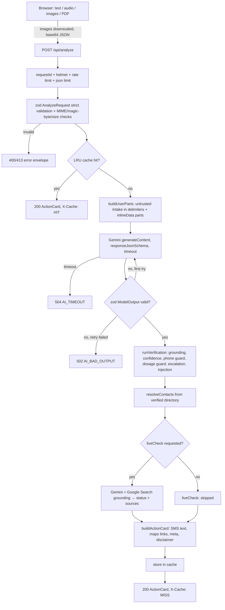

# PROCESS_FLOW.md — LifeBridge

## PURPOSE

Describes how a request moves through LifeBridge, from messy user Intake to a verified Action Card. Terms (Intake, Action Card, Fact, Action, Verification Report, Emergency Contact) are defined in `docs/PRD.md`. Component and file names are defined in `docs/TRD.md`.

## USER JOURNEY

1. User opens the app (`GET /`), and the UI loads `GET /api/config` (languages, countries, AI availability).
2. User provides any mix of: typed or pasted text, a voice recording, photos or PDFs. Or they click a sample Intake.
3. User picks an output language and country, and optionally shares location and enables "Cross-check with live web".
4. User presses **Create Action Card**. The status region announces "Analyzing…".
5. The Action Card renders and focus moves to its heading. The screen reader announces the severity and summary.
6. User reviews Facts marked `needs review`, calls Emergency Contacts via `tel:` links, and reads the card aloud, copies the SMS text, downloads JSON, or prints.

## REQUEST PIPELINE



## VERIFICATION DECISION

```text
facts → grounded (quote in user text) | transcribed (quote in model sourceText) | unverified
groundingScore = (grounded + transcribed) / total facts   (0 when no facts)

status = verified      if no check failed AND evidence_grounding, low_confidence, prompt_injection pass
status = needs_review  otherwise  → UI shows "Needs human review" banner + per-fact badges
```

## FAILURE HANDLING

| Condition | Result | UI behaviour |
|---|---|---|
| No `GEMINI_API_KEY` | 503 `AI_UNAVAILABLE` | alert + still shows emergency numbers for the selected country |
| Gemini timeout | 504 `AI_TIMEOUT` | alert with retry button |
| Invalid model output twice | 502 `AI_BAD_OUTPUT` | alert with retry |
| Rate limited | 429 `RATE_LIMITED` | alert with wait message |
| Live check fails | 200, `liveCheck.status = error` | card shown, live check marked unavailable |

## OPERATIONAL FLOW

```text
git push main → GitHub Actions (lint, typecheck, test+coverage, docker build + /healthz smoke)
gcloud run deploy --source . → Cloud Build → Artifact Registry → Cloud Run (secret from Secret Manager)
Cloud Run stdout JSON → Cloud Logging (severity, requestId, latency; no Intake content)
```
